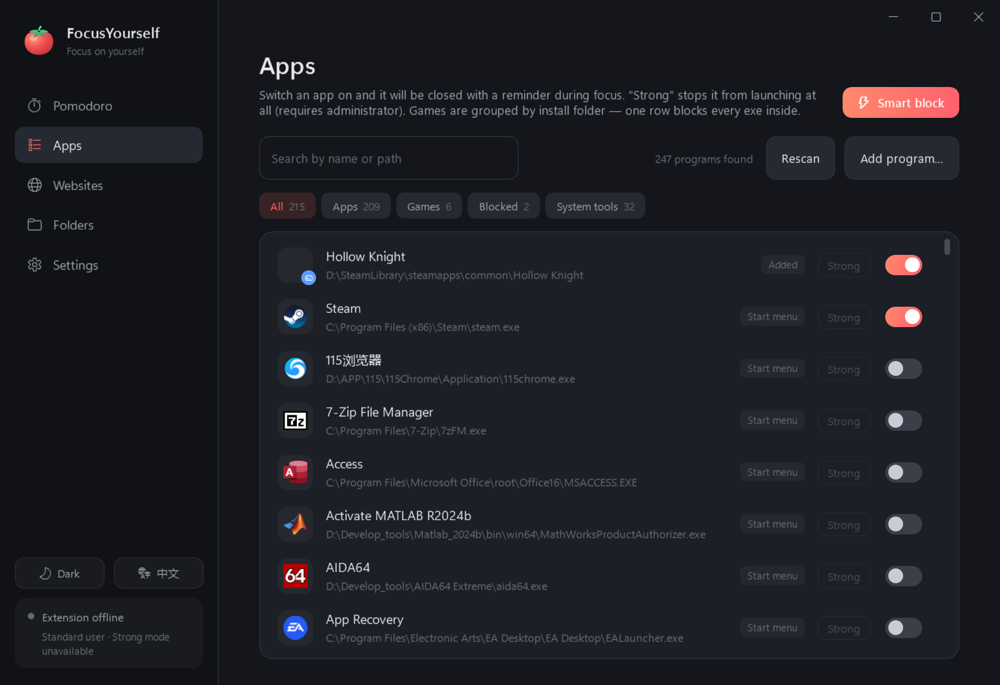
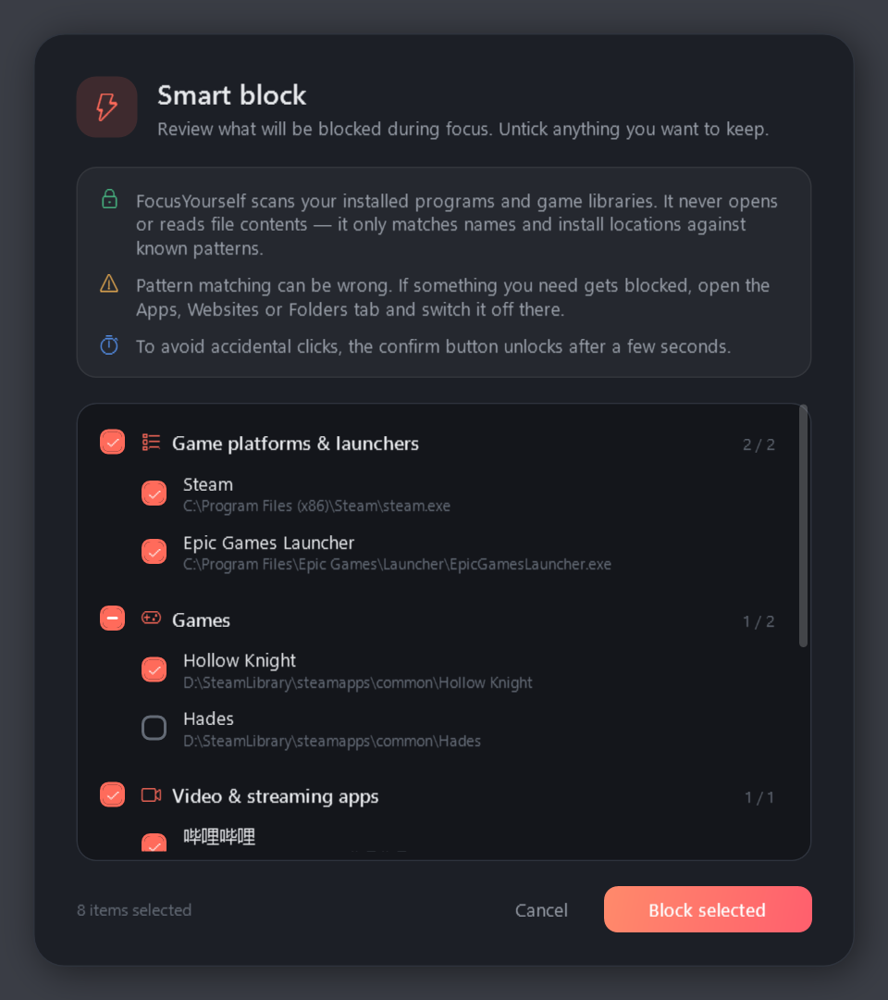
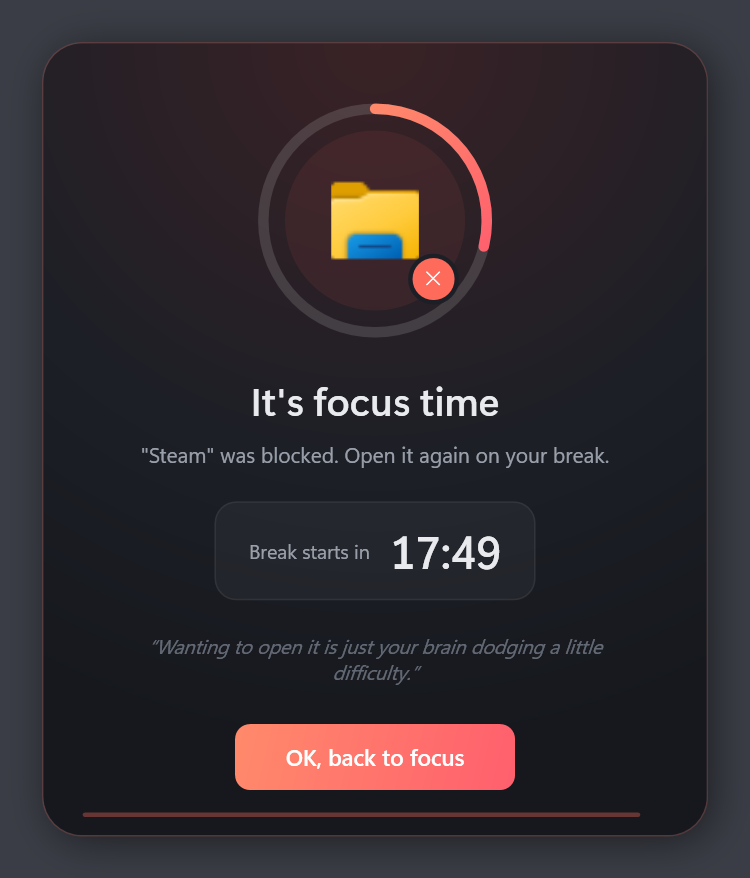
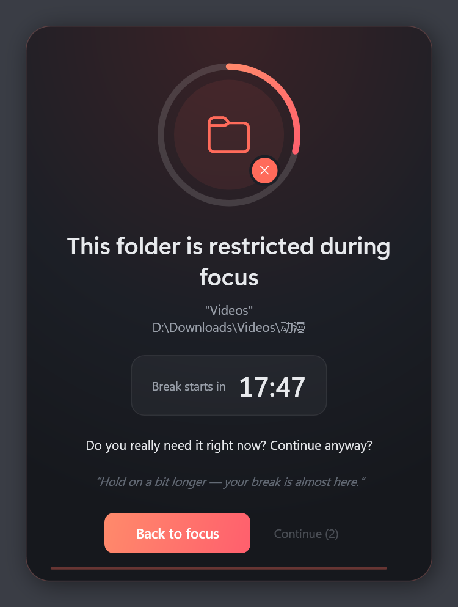

<h1 align="center">FocusYourself</h1>

<p align="center">
  
</p>

<p align="center">
  <b>English</b> &nbsp;|&nbsp; <a href="docs/README_zh.md">简体中文</a>
</p>

<p align="center">
  A pomodoro timer for Windows that keeps distractions out while you focus.<br>
  It blocks apps, websites and folders during focus and lets everything back on a break.
</p>

<p align="center">
  <a href="https://github.com/DreamEdm/focusyourself/releases/latest"></a>
  <a href="https://github.com/DreamEdm/focusyourself/releases"></a>
  <a href="https://github.com/DreamEdm/focusyourself/actions/workflows/ci.yml"></a>
  <a href="LICENSE"></a>
  <br>
  
  
  
  
</p>

<p align="center">
  <a href="../../releases/latest"><b>Download</b></a> ·
  <a href="#features">Features</a> ·
  <a href="#getting-started">Getting started</a> ·
  <a href="#faq">FAQ</a> ·
  <a href="#development">Development</a>
</p>

<p align="center">
  
</p>

## Features

- **Pomodoro timer**: focus, short break and long break rotate automatically, with a chime and a notification card at every phase change. Click the time in the ring to change the focus length (or scroll over it), and a row of little tomatoes shows how far you are into the current set: the one you're working on turns red from the bottom up.
- **Pause**: something came up? Pause the timer (main window or tray) and resume later. Blocking stays on while a focus round is paused, and a reminder with its own chime pops up every 5 minutes so you don't forget to resume.
- **App blocking**: blocked apps are closed the moment they start. Strong mode (admin) stops them from launching at all.
- **Website blocking**: the browser extension sends blocked sites, subdomains included, to a focus page, and brings you back when the break starts. An install guide finds your browsers, opens each one's extensions page for you and ticks it off as soon as the extension connects.
- **Folder reminders**: opening a restricted folder in File Explorer asks "Continue anyway?" before letting you in.
- **Smart block**: one click finds game launchers, games, video apps and distracting websites, and you review the list before anything is blocked.
- **Anti-bypass**: strict mode, a browser guard, and focus sessions that resume after a force-kill.
- **Floating countdown**: always on top, translucent and click-through.
- **Light / Dark / Auto theme, English and 简体中文**: Auto follows Windows and switches live when Windows does.

## Screenshots

<table>
  <tr>
    <td width="50%"></td>
    <td width="50%"></td>
  </tr>
  <tr>
    <td align="center"><sub>Apps: games are grouped by install folder</sub></td>
    <td align="center"><sub>Light theme · 简体中文</sub></td>
  </tr>
</table>

<table>
  <tr>
    <td width="33%"></td>
    <td width="33%"></td>
    <td width="33%"></td>
  </tr>
  <tr>
    <td align="center"><sub>Smart block</sub></td>
    <td align="center"><sub>A blocked app</sub></td>
    <td align="center"><sub>Folder reminder</sub></td>
  </tr>
</table>

## Download

Get the latest version from the [Releases](../../releases/latest) page. It runs on Windows 10 / 11 (x64), and the .NET runtime is bundled.

| File | Description |
| --- | --- |
| `FocusYourself-<version>-win-x64-setup.exe` | **Installer.** Installs to Program Files and adds a Start menu entry (desktop shortcut optional). Uninstalling also removes autostart and any leftover strong-mode blocks. Your settings are kept. |
| `FocusYourself-<version>-win-x64-portable.zip` | **Portable.** Unzip anywhere and run `FocusYourself\FocusYourself.exe`. No install, no admin rights. |

`SHA256SUMS.txt` lists the checksums of both files.

> [!TIP]
> If the app doesn't start (for example, it says a .NET runtime is missing), install the **.NET 10 Desktop Runtime (x64)** from [dotnet.microsoft.com/download/dotnet/10.0](https://dotnet.microsoft.com/download/dotnet/10.0) and try again.

## Getting started

1. Run `FocusYourself.exe`. Closing the window hides it to the system tray. Right-click the tray icon to quit.
2. Install the browser extension: on the Websites tab click **Install the extension…** (or click the extension card on the Pomodoro tab), tick your browsers and click **Start**. For each browser the guide opens its extensions page in a new window and selects the `extension` folder in File Explorer. You then:
   1. Turn on **Developer mode** (top right; bottom of the sidebar in Edge)
   2. Drag the `extension` folder onto the page (or click **Load unpacked** and pick it)
   3. Optional: in the extension's **Details**, enable **Allow in Incognito**

   The guide moves on by itself once the extension connects. Any Chromium-based browser works (Chrome, Edge, Helium, Brave, Vivaldi…); Firefox isn't supported. Browsers don't let other programs install extensions silently, which is why those two clicks are left to you.
3. Click **Smart block**, or pick things yourself on the Apps, Websites and Folders tabs.
4. Go to the Pomodoro tab and click **Start focus**.

To use strong mode, open Settings and click **Restart as administrator**. If you also want strong mode ready right after login, turn on **Start with Windows** while running as administrator. That creates a scheduled task with highest privileges, so you won't get a UAC prompt.

## How it works

<details>
<summary><b>App blocking</b></summary>

- The Apps tab scans the Start menu, installed programs, Steam and Epic games, and running windowed apps. Switch an app on to block it.
- Games are grouped by install folder, so **one row blocks every exe in a game** (launcher, game, crash reporter…).
- Filters: All · Apps · Games · Blocked · System tools. Tools inside the Windows folder are hidden from "All".
- **Standard mode**: a blocked app is closed as soon as it starts, and a focus reminder pops up. No admin rights needed.
- **Strong mode**: an IFEO registry entry stops the app from starting at all. Needs admin. For a game folder it covers every uniquely named exe in that folder.
- When focus starts, blocked apps that are already open get an "N seconds until close" warning, so you have time to save your work.

</details>

<details>
<summary><b>Smart block</b></summary>

It finds game platforms and launchers (Steam, Epic, Battle.net, Ubisoft…), installed games, video and streaming apps, common distracting websites (YouTube, Bilibili, Reddit, X/Twitter, Facebook, Twitch…) and game library folders. Before anything is blocked you get a categorized checklist where you can untick items, and the confirm button unlocks after 3 seconds. Smart block only matches names and install locations and never reads file contents. It never selects browsers, chat apps, developer tools, Office or music players.

</details>

<details>
<summary><b>Website blocking</b></summary>

During focus, blocked sites and all their subdomains redirect to a focus page, and tabs that are already open redirect right away. When the break starts, those tabs go back to the original page. The extension pages follow the app's language and theme.

</details>

<details>
<summary><b>Folder reminders</b></summary>

During focus, opening a restricted folder (or one of its subfolders) in File Explorer sends the window back one level and asks "Continue anyway?". The Continue button unlocks after a few seconds (15 s in strict mode). If you continue, that folder won't be flagged again this round. Folder reminders only affect File Explorer and never change files or permissions.

</details>

<details>
<summary><b>Anti-bypass</b></summary>

- **Strict mode**: during focus you can't quit, unblock anything or change settings. To end a session early you have to wait out a cool-down first.
- **Browser guard**: if Helium is running during focus without the extension connected (disabled or removed), you get a warning, and Helium is closed 15 seconds later.
- If FocusYourself is force-killed, an unfinished focus session resumes when it starts again.
- If the extension loses its connection to the desktop app, it keeps the last blocking state until that focus round's end time has passed.

</details>

## FAQ

<details>
<summary><b>Will blocking Google Chrome also block Helium?</b></summary>

No. Apps are matched by full path. Helium's main program is also called `chrome.exe`, but it lives somewhere else. Game-folder rules match any program started from inside that folder.

</details>

<details>
<summary><b>Why can't some apps use strong mode?</b></summary>

Strong mode works by file name. It can't be used for an exe that shares its name with another program (such as `chrome.exe`), for very generic names, or for system tools, and the UI tells you which reason applies. FocusYourself only ever removes IFEO entries it wrote itself (marked `FocusYourselfOwned`). Some antivirus software may warn about IFEO changes.

</details>

<details>
<summary><b>An app says "Focus has ended" but still won't open</b></summary>

An unexpected exit left strong-mode blocks behind. Open FocusYourself as administrator and it cleans them up automatically. Settings also has a **Clear strong-mode blocks** button. Uninstalling with the installer removes them too.

</details>

<details>
<summary><b>Can a web page talk to the desktop app?</b></summary>

No. The extension connects over `ws://127.0.0.1:47621`, and the app only accepts connections from this extension's ID. If you change the port, also change `BRIDGE_PORT` in `extension/shared.js`.

</details>

<details>
<summary><b>Can it be bypassed?</b></summary>

Yes. The machine's administrator can bypass any software-only approach. The goal is to make getting distracted take more effort, and to add a "wait a moment" step when you're tempted.

</details>

<details>
<summary><b>Where are settings stored?</b></summary>

| File | Contents |
| --- | --- |
| `%AppData%\FocusYourself\config.json` | Rules and settings, including `Language` and `Theme` (`light` / `dark` / `auto`) |
| `%AppData%\FocusYourself\state.json` | Current pomodoro state, used to resume |
| `%AppData%\FocusYourself\error.log` | Unhandled exception log |

The installed and portable versions share this folder.

</details>

## Development

You need the [.NET 10 SDK](https://dotnet.microsoft.com/download/dotnet/10.0). Node.js runs the extension tests, and Python with Pillow runs the icon generator.

```
src/FocusYourself.App/
  Core/          config models, path/domain helpers, rule safety, localization (Loc + Strings)
  Services/      pomodoro engine, process blocker, IFEO, extension bridge, app scanner, smart block, chimes, coordinator
  ViewModels/    UI logic (CommunityToolkit.Mvvm)
  Views/         main window, blocked popup, smart-block dialog, toasts, floating countdown, theme manager
  Themes/        Colors.Dark.xaml / Colors.Light.xaml (same keys) + Theme.xaml styles
extension/       Chromium MV3 extension (Helium / Chrome / Edge)
installer/       Inno Setup script
tests/           unit and integration tests
tools/           release script, icon generator, extension tests
docs/            screenshots, logo, Chinese README
```

```bash
dotnet test                       # unit / integration tests
FY_EXPLORER_TEST=1 dotnet test    # also run the real File Explorer test (briefly opens an Explorer window)
node tools/test_extension.mjs     # extension rules and i18n
python tools/make_icons.py        # regenerate icons and the README logo
FY_SCREENSHOTS=docs/screenshots dotnet test --filter ScreenshotTests   # regenerate screenshots (rendered offscreen)
```

All UI text lives in `Core/Strings.cs`. The `En` and `Zh` tables must have identical keys and placeholders, and a test checks this and that every key used in `.cs` / `.xaml` exists. Use `{l:T Key}` in XAML and `Loc.T("Key")` / `Loc.F("Key", args)` in code. Reference brushes with `DynamicResource` so theme changes apply live.

### Building a release

You also need [Inno Setup 6](https://jrsoftware.org/isinfo.php) (`winget install JRSoftware.InnoSetup`).

```bash
powershell -ExecutionPolicy Bypass -File tools/build-release.ps1                 # version from the .csproj
powershell -ExecutionPolicy Bypass -File tools/build-release.ps1 -Version 1.2.0
```

The script publishes a self-contained single-file build and writes the installer, the portable zip and `SHA256SUMS.txt` to `release/`, which git doesn't track. Pass `-SkipInstaller` to build only the zip. To get a Simplified Chinese installer UI, put Inno Setup's unofficial `ChineseSimplified.isl` in `installer/`.

Pushing a `v*` tag runs [`release.yml`](.github/workflows/release.yml), which tests, builds both packages and attaches them to a draft GitHub release. [`ci.yml`](.github/workflows/ci.yml) runs the tests on pushes to `main` and on pull requests.

```bash
git tag v1.0.0
git push origin v1.0.0
```

## License

[MIT](LICENSE) © DreamEdm
