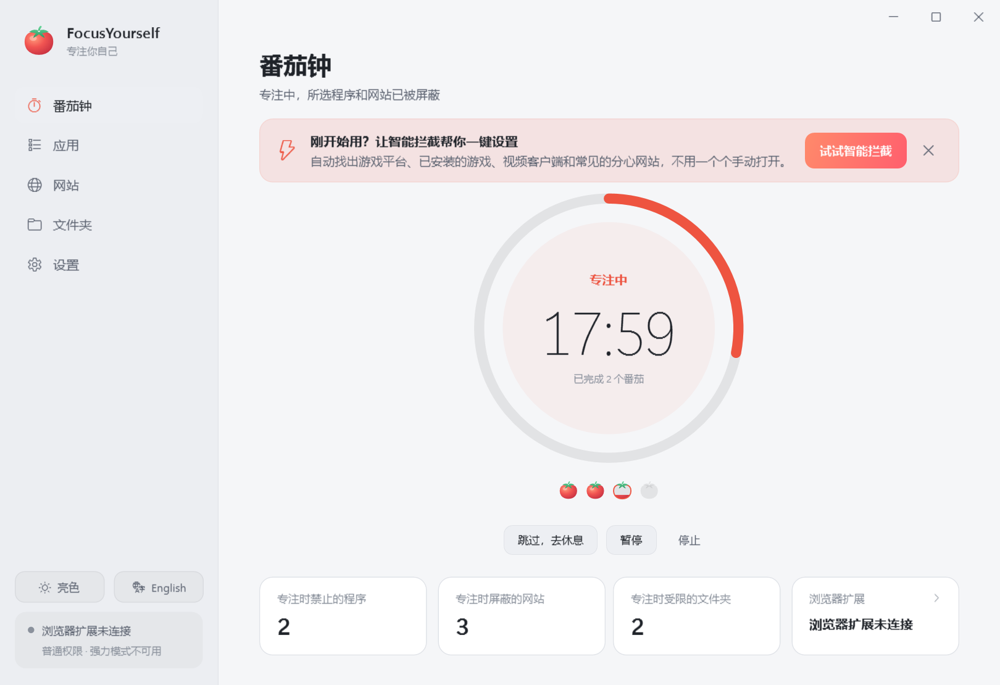
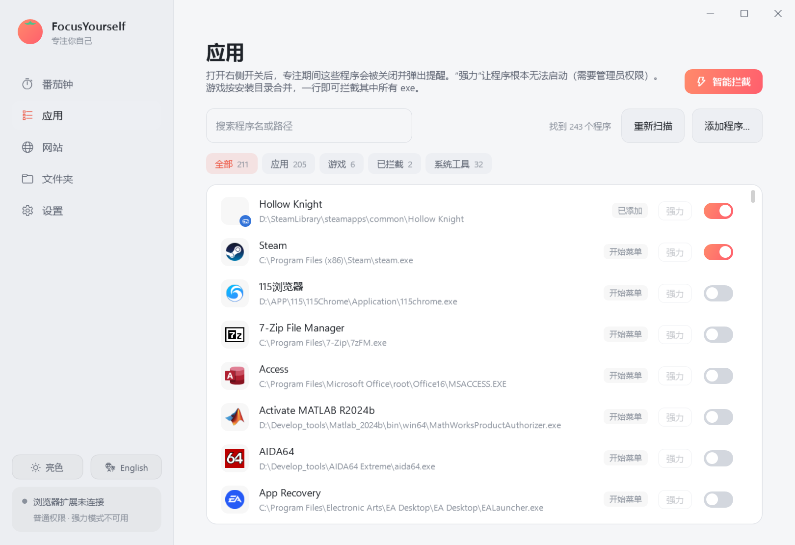
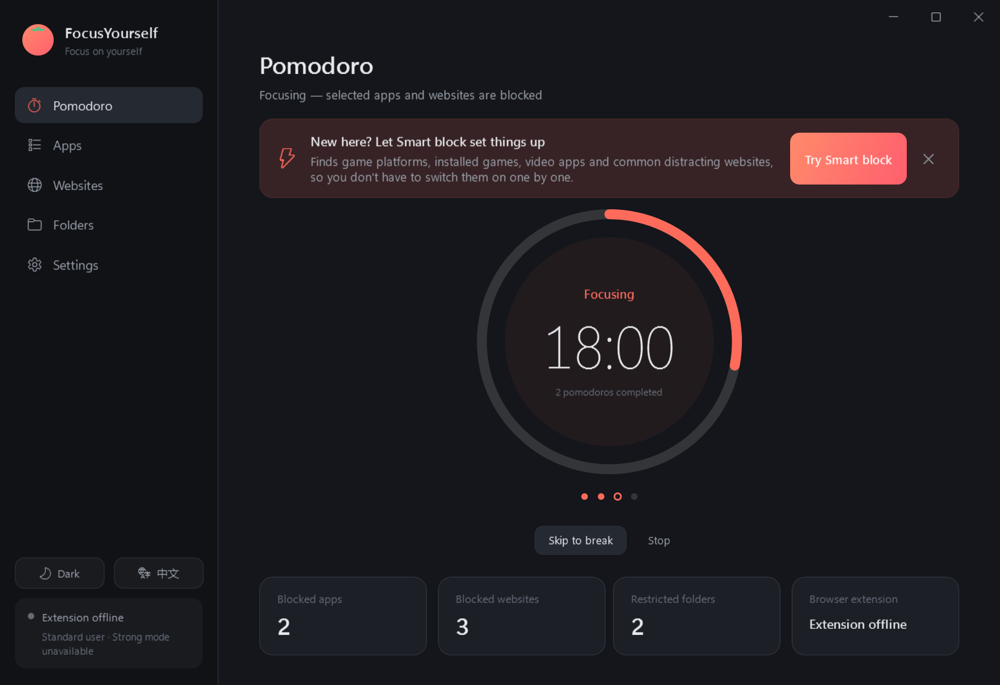
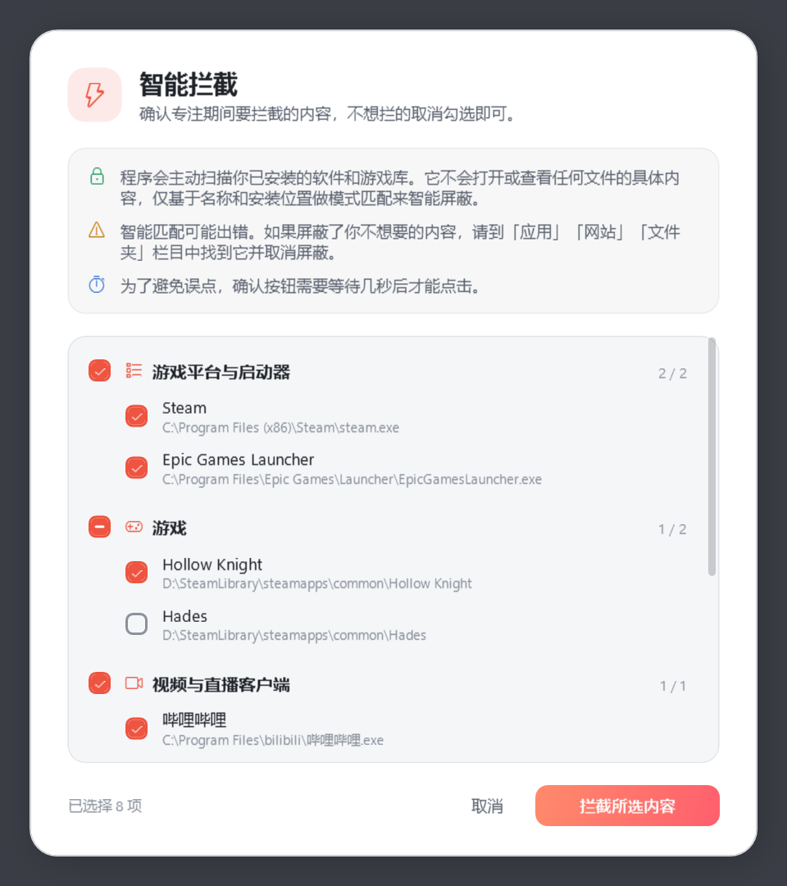
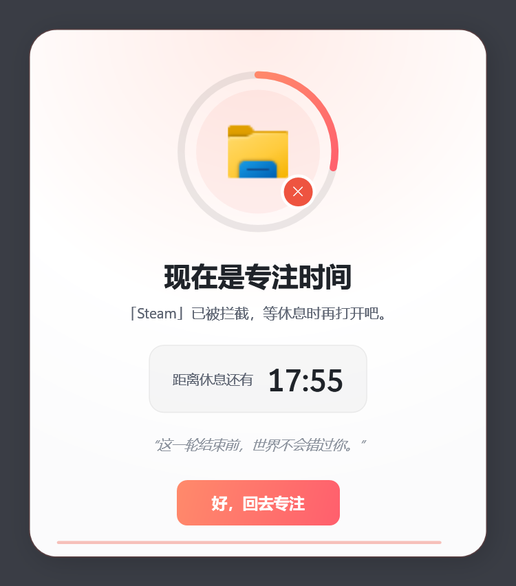
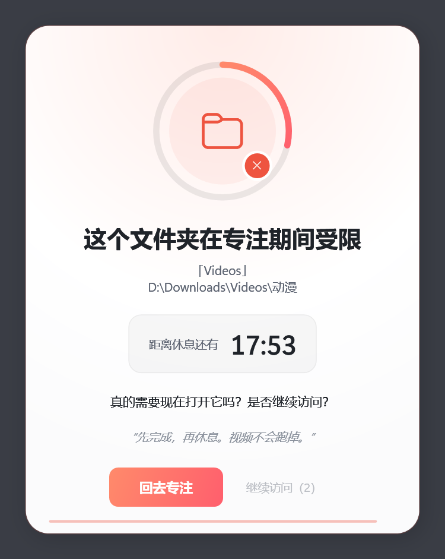

<h1 align="center">FocusYourself</h1>

<p align="center">
  
</p>

<p align="center">
  <a href="../README.md">English</a> &nbsp;|&nbsp; <b>简体中文</b>
</p>

<p align="center">
  让你真正专注下来的 Windows 番茄钟。<br>
  专注时拦截程序、网站和文件夹，休息时一切恢复。
</p>

<p align="center">
  <a href="https://github.com/DreamEdm/focusyourself/releases/latest"></a>
  <a href="https://github.com/DreamEdm/focusyourself/releases"></a>
  <a href="https://github.com/DreamEdm/focusyourself/actions/workflows/ci.yml"></a>
  <a href="../LICENSE"></a>
  <br>
  
  
  
  
</p>

<p align="center">
  <a href="../../../releases/latest"><b>下载</b></a> ·
  <a href="#功能">功能</a> ·
  <a href="#快速上手">快速上手</a> ·
  <a href="#常见问题">常见问题</a> ·
  <a href="#开发">开发</a>
</p>

<p align="center">
  
</p>

## 功能

- **番茄钟**：专注、短休息、长休息自动轮转；每次切换阶段都会播放提示音并弹出通知卡片。
- **程序拦截**：专注期间被禁的程序一启动就会被关掉；强力模式（需要管理员）能让它根本启动不了。
- **网站屏蔽**：浏览器扩展把被屏蔽的网站（含所有子域名）跳转到专注页面，休息开始后自动回到原网页。
- **文件夹提醒**：在资源管理器里打开受限文件夹时，会先问你“是否继续访问？”。
- **智能拦截**：一键找出游戏平台、已安装的游戏、视频软件和分心网站；拦截前会先列出清单让你确认。
- **防绕过**：严格模式、浏览器守护；强行结束程序后再打开，未完成的专注会继续。
- **悬浮倒计时**：置顶、半透明，鼠标点击会直接穿透。
- **亮色 / 暗色 / 自动主题，English / 简体中文**：“自动”跟随 Windows 设置，系统切换时立即跟着变。

## 截图

<table>
  <tr>
    <td width="50%"></td>
    <td width="50%"></td>
  </tr>
  <tr>
    <td align="center"><sub>应用页：游戏按安装目录合并</sub></td>
    <td align="center"><sub>暗色主题 · English</sub></td>
  </tr>
</table>

<table>
  <tr>
    <td width="33%"></td>
    <td width="33%"></td>
    <td width="33%"></td>
  </tr>
  <tr>
    <td align="center"><sub>智能拦截</sub></td>
    <td align="center"><sub>程序被拦截</sub></td>
    <td align="center"><sub>文件夹提醒</sub></td>
  </tr>
</table>

## 下载

在 [Releases](../../../releases/latest) 页面下载最新版本。支持 Windows 10 / 11（x64），已自带 .NET 运行时。

| 文件 | 说明 |
| --- | --- |
| `FocusYourself-<版本>-win-x64-setup.exe` | **安装版**。安装到 Program Files，创建开始菜单项（桌面快捷方式可选）。卸载时会一并移除开机自启和残留的强力模式拦截，设置会保留。 |
| `FocusYourself-<版本>-win-x64-portable.zip` | **便携版**。解压到任意文件夹，运行 `FocusYourself\FocusYourself.exe` 即可，不用安装，也不需要管理员权限。 |

`SHA256SUMS.txt` 是两个文件的校验和。

> [!TIP]
> 如果打不开（例如提示缺少 .NET 运行时），请到 [dotnet.microsoft.com/download/dotnet/10.0](https://dotnet.microsoft.com/download/dotnet/10.0) 安装 **.NET 10 桌面运行时（Desktop Runtime，x64）** 后再试。

## 快速上手

1. 运行 `FocusYourself.exe`。关闭窗口只是隐藏到托盘，右键托盘图标可以退出。
2. 在 Helium / Chrome / Edge 中安装浏览器扩展（“网站”页有按钮可以复制地址、打开文件夹）：
   1. 地址栏打开 `chrome://extensions`
   2. 打开右上角的 **开发者模式**
   3. 点 **加载已解压的扩展程序**，选择 `FocusYourself.exe` 旁边的 `extension` 文件夹
   4. 在扩展 **详情** 里打开 **在无痕模式下启用**
3. 点 **智能拦截**，或者在“应用”“网站”“文件夹”页手动选择要拦截的内容。
4. 回到“番茄钟”页，点 **开始专注**。

想用强力模式：打开设置，点 **以管理员身份重启**。如果希望开机后强力模式直接可用，请在管理员身份下打开 **开机自动启动**。这会创建一个以最高权限运行的计划任务，开机时不会再弹 UAC。

## 工作方式

<details>
<summary><b>程序拦截</b></summary>

- “应用”页会自动扫描开始菜单、已安装程序、Steam 与 Epic 游戏，以及正在运行的窗口程序，打开开关即可拦截。
- 游戏按安装目录合并：**一行就能拦住整个游戏**的所有 exe（启动器、游戏本体、崩溃报告等）。
- 分类筛选：全部 · 应用 · 游戏 · 已拦截 · 系统工具。Windows 目录里的工具默认不在“全部”里显示。
- **标准模式**：被禁程序一启动就会被关闭，并弹出专注提示窗。不需要管理员权限。
- **强力模式**：通过 IFEO 注册表让程序根本无法启动，需要管理员权限。对游戏目录，会覆盖其中所有文件名唯一的 exe。
- 专注开始时，已经打开的被禁程序会先收到“N 秒后关闭”的提醒，留出保存时间。

</details>

<details>
<summary><b>智能拦截</b></summary>

自动找出游戏平台与启动器（Steam、Epic、战网、育碧等）、已安装的游戏、视频与直播客户端、常见分心网站（YouTube、Bilibili、Reddit、X/Twitter、Facebook、Twitch 等）以及游戏库文件夹。拦截前会列出分类清单，可以逐项取消勾选，确认按钮要等 3 秒才能点。智能拦截只按名称和安装位置匹配，不读取任何文件内容。浏览器、聊天软件、开发工具、Office 和音乐播放器永远不会被选中。

</details>

<details>
<summary><b>网站屏蔽</b></summary>

专注期间，被屏蔽的网站（含所有子域名）会跳转到专注页面，已经打开的标签页也会立即跳转。休息开始后，这些标签页会自动回到原网页。扩展页面也跟随桌面端的语言和主题。

</details>

<details>
<summary><b>文件夹提醒</b></summary>

专注期间在资源管理器里打开受限文件夹（含子文件夹）时，窗口会退回上一级，并弹出“是否继续访问？”。“继续访问”要等几秒才能点（严格模式下 15 秒）。选择继续后，本轮专注内这个文件夹不会再提醒。文件夹提醒只作用于资源管理器，不会修改任何文件或权限。

</details>

<details>
<summary><b>防绕过</b></summary>

- **严格模式**：专注期间不能退出、不能解除拦截、不能改设置。想提前结束，要先等冷静期过去。
- **浏览器守护**：专注期间 Helium 在运行但扩展没有连接（被禁用或卸载）时，会先提醒，15 秒后关闭 Helium。
- 强行结束 FocusYourself 后再打开，未结束的专注会继续。
- 扩展与桌面端断开连接时，会保持最后的屏蔽状态，直到那一轮专注的结束时间过去。

</details>

## 常见问题

<details>
<summary><b>禁止 Google Chrome 会不会把 Helium 也拦住？</b></summary>

不会。程序按完整路径识别。Helium 的主程序虽然也叫 `chrome.exe`，但安装位置不同。游戏目录规则会匹配从该目录里启动的任何程序。

</details>

<details>
<summary><b>为什么有的程序不能用强力模式？</b></summary>

强力模式按文件名生效，所以和其它程序同名的 exe（如 `chrome.exe`）、太通用的文件名以及系统工具都不能用，界面会说明是哪种原因。FocusYourself 只会清理自己写入的 IFEO 项（带 `FocusYourselfOwned` 标记）。部分杀毒软件可能对 IFEO 修改发出提醒。

</details>

<details>
<summary><b>程序提示“专注已经结束”，但还是打不开</b></summary>

这是程序异常退出后留下了强力模式拦截。以管理员身份打开 FocusYourself 就会自动清理；设置页也有 **清理强力模式拦截** 按钮。用安装版卸载时也会一并清理。

</details>

<details>
<summary><b>普通网页能连上桌面端吗？</b></summary>

不能。扩展通过 `ws://127.0.0.1:47621` 与桌面端通信，桌面端只接受本扩展 ID 的连接。修改端口时，需要同时修改 `extension/shared.js` 中的 `BRIDGE_PORT`。

</details>

<details>
<summary><b>能被绕过吗？</b></summary>

能。任何纯软件方案都能被本机管理员绕过。这个工具的目标是提高绕过成本，让你想分心时多一道“冷静一下”的门槛。

</details>

<details>
<summary><b>设置保存在哪里？</b></summary>

| 文件 | 内容 |
| --- | --- |
| `%AppData%\FocusYourself\config.json` | 规则与设置，含 `Language`、`Theme`（`light` / `dark` / `auto`） |
| `%AppData%\FocusYourself\state.json` | 番茄钟当前状态，用于恢复 |
| `%AppData%\FocusYourself\error.log` | 未处理异常日志 |

安装版和便携版共用这个文件夹。

</details>

## 开发

需要 [.NET 10 SDK](https://dotnet.microsoft.com/download/dotnet/10.0)。扩展测试要用 Node.js，图标生成要用 Python + Pillow。

```
src/FocusYourself.App/
  Core/          配置模型、路径/域名工具、规则安全检查、本地化（Loc + Strings）
  Services/      番茄钟引擎、进程拦截、IFEO、扩展通信、程序扫描、智能拦截、提示音、协调器
  ViewModels/    界面逻辑（CommunityToolkit.Mvvm）
  Views/         主窗口、拦截弹窗、智能拦截对话框、通知、悬浮倒计时、主题管理
  Themes/        Colors.Dark.xaml / Colors.Light.xaml（键相同）+ Theme.xaml 样式
extension/       Chromium MV3 扩展（Helium / Chrome / Edge）
installer/       Inno Setup 安装脚本
tests/           单元测试和集成测试
tools/           发布脚本、图标生成、扩展测试
docs/            截图、图标、中文 README
```

```bash
dotnet test                       # 单元 / 集成测试
FY_EXPLORER_TEST=1 dotnet test    # 同时运行真实的资源管理器测试（会短暂打开一个资源管理器窗口）
node tools/test_extension.mjs     # 扩展规则与多语言
python tools/make_icons.py        # 重新生成图标和 README 图标
FY_SCREENSHOTS=docs/screenshots dotnet test --filter ScreenshotTests   # 重新生成截图（离屏渲染，不弹窗）
```

所有界面文字都在 `Core/Strings.cs`。`En` 和 `Zh` 两张表的键和占位符必须一致，有测试检查这一点，并检查 `.cs` / `.xaml` 中用到的每个键都存在。XAML 里用 `{l:T Key}`，代码里用 `Loc.T("Key")` / `Loc.F("Key", args)`。画刷一律用 `DynamicResource` 引用，主题切换才能即时生效。

### 构建发布包

另外需要 [Inno Setup 6](https://jrsoftware.org/isinfo.php)（`winget install JRSoftware.InnoSetup`）。

```bash
powershell -ExecutionPolicy Bypass -File tools/build-release.ps1                 # 版本号取自 .csproj
powershell -ExecutionPolicy Bypass -File tools/build-release.ps1 -Version 1.1.0
```

脚本会生成自包含的单文件程序，并把安装包、便携版 zip 和 `SHA256SUMS.txt` 输出到 `release/`（git 不跟踪这个目录）。加 `-SkipInstaller` 只生成 zip。想让安装包有简体中文界面，把 Inno Setup 的非官方翻译 `ChineseSimplified.isl` 放进 `installer/` 即可。

推送 `v*` 标签会触发 [`release.yml`](../.github/workflows/release.yml)：自动测试、打包，并把两个包附到 GitHub Release 草稿里。[`ci.yml`](../.github/workflows/ci.yml) 会在推送到 `main` 和提交 PR 时运行测试。

```bash
git tag v1.0.0
git push origin v1.0.0
```

## 许可证

[MIT](../LICENSE) © DreamEdm
